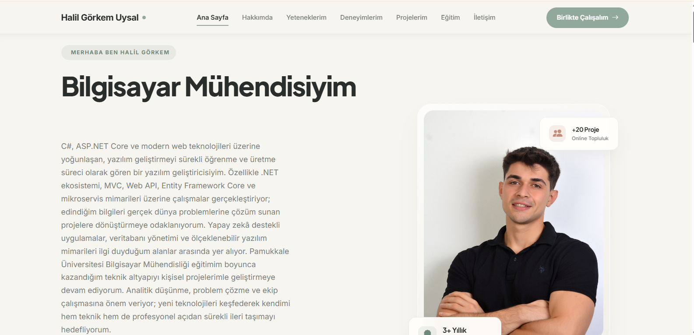
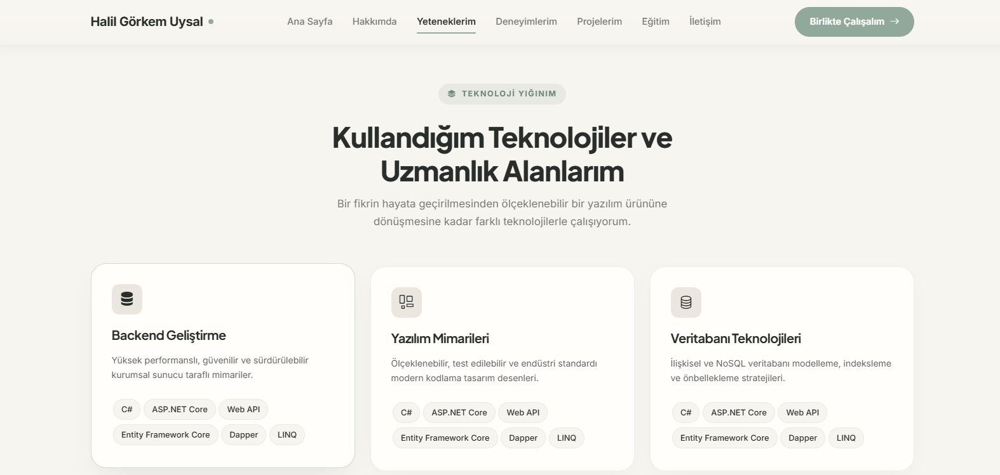
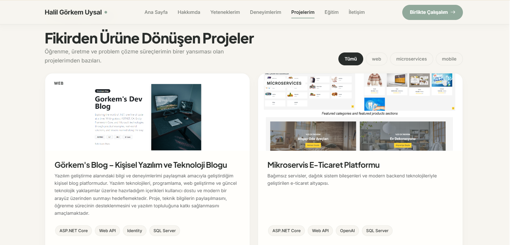
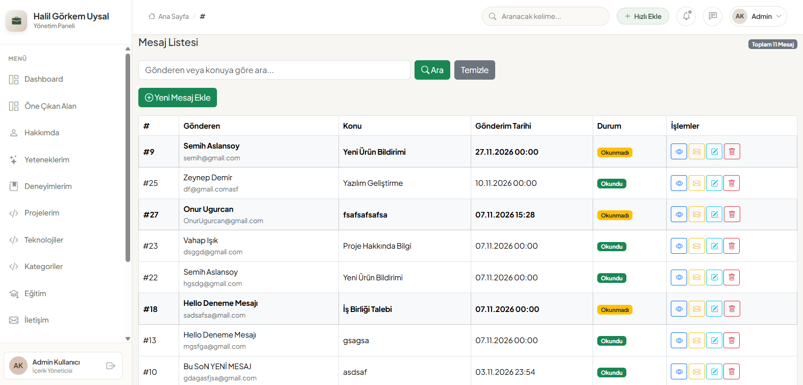
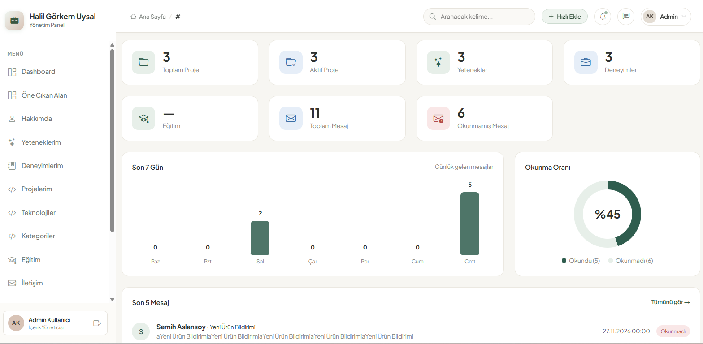
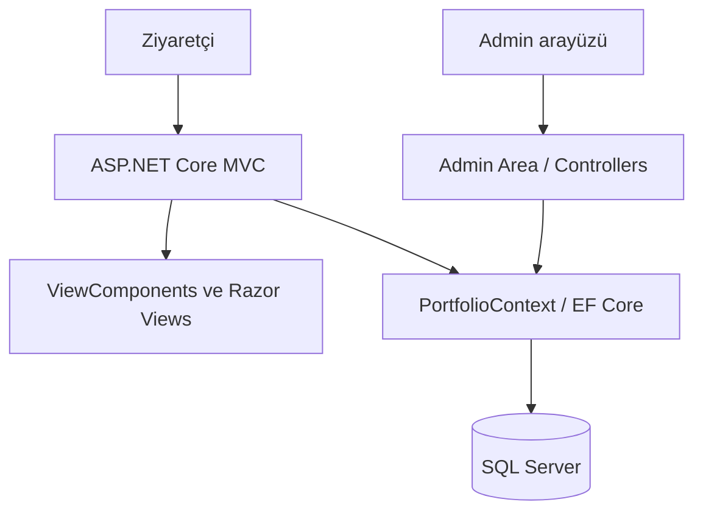

<div align="center">

# ✨ MYAcademy | Portfolio Project

### ASP.NET Core MVC ile geliştirdiğim dinamik portfolyo ve içerik yönetim uygulaması

<p>
  
  
  
  
  
</p>

**[🌐 Portfolyo](#-ziyaretçi-tarafı)** &nbsp;•&nbsp; **[🛠️ Admin Paneli](#%EF%B8%8F-admin-paneli)** &nbsp;•&nbsp; **[🖼️ Ekran Görüntüleri](#%EF%B8%8F-ekran-g%C3%B6r%C3%BCnt%C3%BCleri)** &nbsp;•&nbsp; **[⚙️ Kurulum](#%EF%B8%8F-kurulum)**

---



<sub>Projenin GitHub deposundaki gerçek ekran görüntülerinden biri</sub>

</div>

## 📖 Proje Hakkında

**MYAcademy Portfolio Project**, kendi çalışmalarımı, deneyimlerimi, eğitim geçmişimi ve teknik yeteneklerimi tek bir yerde sunmak amacıyla geliştirdiğim **veritabanı destekli kişisel portfolyo** uygulamasıdır.

Projenin ziyaretçi tarafında portfolyo içerikleri sunulurken, **Admin Area** üzerinden bu içerikler yönetilebilir. ASP.NET Core MVC ve Entity Framework Core ile sayfaların içeriklerini veritabanından alacak şekilde yapılandırdım. Tekrarlanan arayüz bölümlerini **ViewComponent** kullanarak modüler hale getirdim.

## 🧭 Bölümlere Hızlı Erişim

| Bölüm | Açıklama |
|:---|:---|
| [🏠 Ziyaretçi arayüzü](#-ziyaretçi-tarafı) | Portfolyo sayfası ve içerik alanları |
| [🛠️ Admin paneli](#%EF%B8%8F-admin-paneli) | Yönetim modülleri ve dashboard |
| [🖼️ Görsel galeri](#%EF%B8%8F-ekran-g%C3%B6r%C3%BCnt%C3%BCleri) | Repodaki 5 ekran görüntüsü |
| [🧱 Mimari](#-proje-mimarisi) | MVC, ViewComponent, EF Core |
| [⚙️ Kurulum](#%EF%B8%8F-kurulum) | Yerel ortamda çalıştırma |

## 🧰 Teknoloji Yığını

| Katman | Teknolojiler |
|:---|:---|
| Backend | C#, ASP.NET Core 9 MVC |
| Veri erişimi | Entity Framework Core 9, LINQ |
| Veritabanı | Microsoft SQL Server |
| Arayüz | Razor Views, HTML, CSS, JavaScript, Bootstrap |
| Yapı | MVC, Areas, ViewComponents, Entity sınıfları, DbContext |
| Veritabanı şema yönetimi | EF Core Migrations |

## 🏠 Ziyaretçi Tarafı

Portfolyomu ziyaret edenlerin projelerimi ve yetkinliklerimi kolayca inceleyebilmesi için sayfayı birbirini tamamlayan bölümler halinde oluşturdum.

<details open>
<summary><b>✨ Portfolyo sayfası — bölümleri görüntüle</b></summary>

<br>

- **Hero / karşılama:** İlk izlenimi oluşturan tanıtım alanı ve başlıklar.
- **Hakkımda:** Kişisel ve profesyonel tanıtım içerikleri.
- **Yetenekler ve teknolojiler:** Teknik yetkinliklerin sunumu.
- **Projeler:** Çalışmaların kategorilerle birlikte sergilenmesi.
- **Deneyimler:** Profesyonel geçmişin listelenmesi.
- **Eğitim:** Eğitim hayatına ilişkin bilgiler.
- **İletişim:** İletişim bilgileri ve form arayüzü.
- **Footer:** Sayfanın alt bilgi bölümü.

> Not: İletişim formunun görünümü projede yer alıyor. Formun sunucu tarafına mesaj kaydettiği doğrulanmadığından bu özellik burada iddia edilmemektedir.

</details>

## 🛠️ Admin Paneli

Admin tarafını ayrı bir **ASP.NET Core Area** altında geliştirdim. Böylece portfolyo sayfasını oluşturan verileri merkezi bir arayüzden yönetebilecek modüller oluşturdum.

**Aşağıdaki başlıklara tıklayarak ilgili yönetim özelliklerini açabilirsin.**

<details>
<summary><b>📊 Dashboard — istatistikler ve özetler</b></summary>

<br>

Dashboard, uygulamanın genel durumunu tek ekrandan takip etmek için hazırlanmıştır:

- Toplam ve aktif proje sayıları
- Yetenek ve deneyim sayıları
- Toplam, okunmuş ve okunmamış mesaj sayıları
- Son gelen 5 mesaj
- Son eklenen 3 proje
- Kategorilere göre proje dağılımı
- Son 7 gündeki mesaj sayılarının özeti

</details>

<details>
<summary><b>🗂️ Proje ve kategori yönetimi</b></summary>

<br>

- Portfolyo projelerini listeleme, ekleme ve düzenleme
- Proje kayıtlarını silme
- Projeleri kategorilerle ilişkilendirme
- Kategoriler için ekleme, güncelleme ve listeleme ekranları

</details>

<details>
<summary><b>👨‍💻 Hakkımda, hero ve başlık yönetimi</b></summary>

<br>

- Hakkımda içeriğini yönetme
- Hero alanı için görsel/içerik düzenleme
- Açılış bölümündeki başlık ve açıklamaları yönetme
- Teknoloji içeriklerini düzenleme

</details>

<details>
<summary><b>🎓 Eğitim, deneyim ve yetenek yönetimi</b></summary>

<br>

- Eğitim geçmişi kayıtları
- Deneyim kayıtları
- Yetkinlik ve yetenek öğeleri
- Teknoloji listesi ve sunumu

Bu alanların her biri için ayrı controller ve Razor yönetim ekranları bulunur.

</details>

<details>
<summary><b>✉️ Mesaj yönetimi</b></summary>

<br>

- Gönderene veya konuya göre arama
- Mesajları yeniden eskiye sıralama
- Mesaj detayını görüntüleme
- Okundu / okunmadı durumunu değiştirme
- Okunmamış ve toplam mesaj sayılarını takip etme
- Mesaj silme ve yönetim ekranından kayıt oluşturma

</details>

<details>
<summary><b>📇 İletişim bilgileri yönetimi</b></summary>

<br>

İletişim bölümünde kullanılan içerikler için ayrı **Contact** yönetim ekranları yer alır.

</details>

> **Geliştirme notu:** Mevcut admin controller'larında rol bazlı `[Authorize]` koruması doğrulanmadı. Uygulamayı internete açık şekilde yayımlamadan önce kimlik doğrulama ve yetkilendirme eklenmelidir.

## 🖼️ Ekran Görüntüleri

Aşağıdaki görseller depodaki **`images/`** klasöründen doğrudan yüklenir. Görselleri değiştirmek için aynı dosya adlarıyla yeni ekran görüntülerini bu klasöre yükleyebilirsin.

<details open>
<summary><b>🖥️ Görsel 1 — Portfolyo görünümü</b></summary>

<br>
<p align="center"></p>
</details>

<details>
<summary><b>🖥️ Görsel 2 — Uygulama ekranı</b></summary>

<br>
<p align="center"></p>
</details>

<details>
<summary><b>🖥️ Görsel 3 — Uygulama ekranı</b></summary>

<br>
<p align="center"></p>
</details>

<details>
<summary><b>🖥️ Görsel 4 — Uygulama ekranı</b></summary>

<br>
<p align="center"></p>
</details>

<details>
<summary><b>🖥️ Görsel 5 — Uygulama ekranı</b></summary>

<br>
<p align="center"></p>
</details>

## 🧱 Proje Mimarisi



<details>
<summary><b>📁 Klasör yapısını göster</b></summary>

```text
MYAcademy_PortfolioProject/
├── images/                           # README ekran görüntüleri
│   ├── giris.png
│   ├── giris2.png
│   ├── giris3.png
│   ├── giris4.png
│   └── giris5.png
├── MYAcademy_PortfolioProject/
│   ├── Areas/Admin/
│   │   ├── Controllers/               # Admin yönetim modülleri
│   │   ├── ViewComponents/
│   │   └── Views/
│   ├── Context/PortfolioContext.cs    # EF Core veritabanı bağlamı
│   ├── Controllers/                    # Ziyaretçi controller'ları
│   ├── Entities/                       # Alan modelleri
│   ├── Migrations/                     # Veritabanı geçişleri
│   ├── ViewComponents/                 # Ön yüz bileşenleri
│   ├── ViewModels/
│   ├── Views/
│   ├── wwwroot/                        # CSS, JS, görsel dosyaları
│   ├── Program.cs
│   └── MYAcademy_PortfolioProject.csproj
└── MYAcademy_PortfolioProject.slnx
```

</details>

## ⚙️ Kurulum

<details>
<summary><b>🚀 Yerel bilgisayarda çalıştırma adımları</b></summary>

<br>

**Gereksinimler:** .NET 9 SDK, SQL Server ve Visual Studio veya .NET CLI.

**1. Repoyu klonla**

```bash
git clone https://github.com/HalilGorkemUysal/MYAcademy_PortfolioProject.git
cd MYAcademy_PortfolioProject
```

**2. SQL Server bağlantısını yapılandır**

Mevcut kaynak kodda `Context/PortfolioContext.cs` içinde `OnConfiguring()` ile tanımlanmış yerel bir SQL Server bağlantısı bulunuyor. Kendi ortamına göre bağlantıyı düzenle. Daha güvenli bir kullanım için bağlantı bilgisini **User Secrets veya ortam değişkenine** taşıyıp `DbContext` yapılandırmasını `Program.cs` üzerinden yapman önerilir.

**3. Veritabanı geçişlerini uygula**

```bash
dotnet tool install --global dotnet-ef
dotnet ef database update --project MYAcademy_PortfolioProject
```

**4. Projeyi çalıştır**

```bash
dotnet run --project MYAcademy_PortfolioProject
```

Uygulamanın açıldığı adresi terminal çıktısından kontrol et.

</details>

## 🎯 Bu Projede Neler Öğrendim?

Bu projeyi geliştirirken **MVC organizasyonu, EF Core ile ilişkisel veri yönetimi, yönetim panelleri, Razor Views ve ViewComponent temelli modüler arayüz tasarımı** üzerinde çalıştım. Özellikle ziyaretçiye gösterilen veriler ile içerik yönetimi ekranlarını ayrı tutmanın uygulama geliştirme ve bakım süreçlerine sağladığı avantajları deneyimledim.

---

<div align="center">

### ⭐ Projeyi beğendiysen yıldız bırakabilirsin!

[**GitHub Profilim**](https://github.com/HalilGorkemUysal) · [**Proje Reposu**](https://github.com/HalilGorkemUysal/MYAcademy_PortfolioProject)

<sub>Geliştiren: Halil Görkem Uysal</sub>

</div>
